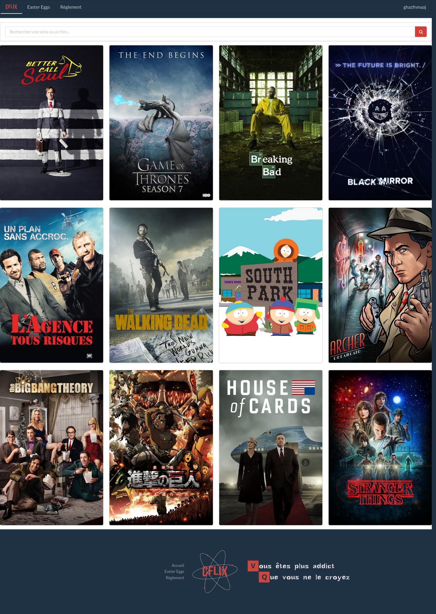

# CFlix: an IT security challenge

CFlix is a self-hostable, hands-on IT security challenge. Each exercise
reproduces a specific flaw and shows how an attacker goes about exploiting it.
Every challenge illustrates an item of the
[OWASP Top Ten](https://owasp.org/www-project-top-ten/) — the reference list of
the most common security flaws found on the web.

Spin it up with Docker and try to solve them all.

---

This repository is split in two parts.

The [docs](docs) part contains the explanation of the challenges and how they
are solved.

The [src](src) part contains the sources of the different projects that make up
the challenges.

## Scenario

The starting point is CFlix, a streaming website that has just launched and
lets its users access the latest seasons of their favorite TV shows.



A hacker nicknamed Hackonymousoflix (the Ugly Duckling) found flaws on the site
and had fun exploiting them...

You must solve the various challenges to understand how he took control of the
platform. Then, in a second stage, you turn the tables on the attacker and
exploit Hackonymousoflix's own servers.

NB: each TV show available on CFlix maps to one main challenge.

The challenges are grouped into three stages that you can unlock progressively
(see [src/README.md](src/README.md)). Four bonus challenges are also available.

## Architecture and deployment

The project is split into three main projects: CFlix, Hackonymousoflix and
Hackonymousoflix.RobotShop.

- **CFlix** is an ASP.NET Core (.NET 10) application, to demonstrate how a flaw
  can be introduced in a C# application.
- **Hackonymousoflix** focuses on Node.js and system exploitation (binary
  exploitation).
- **Hackonymousoflix.RobotShop** provides a last challenge written in PHP.

All these projects are packaged as containers, and a
[docker-compose](src/docker-compose.yml) file describes the interactions and the
layout between them.

To run the whole project, follow the steps described in the [CFlix](src/README.md)
documentation.

## External resources

The images used for the TV shows come from [The Movie DB](https://www.themoviedb.org/).

The icons used for the easter eggs come from [FlatIcon](https://www.flaticon.com/),
except for the `La contre-attaque` easter egg, which comes from the anime Attack
on Titan (Shingeki no Kyojin) and was redrawn in vector format.

## Try it yourself

To run it locally:

```bash
cd src
docker compose build
docker compose up -d
docker compose exec cflix dotnet CFlix.dll database update all
```

Then browse to `https://localhost/`.

To verify that every intentional flaw and easter egg still works, an automated
integration test suite is available under [tests](tests) (see
[tests/README.md](tests/README.md)).
